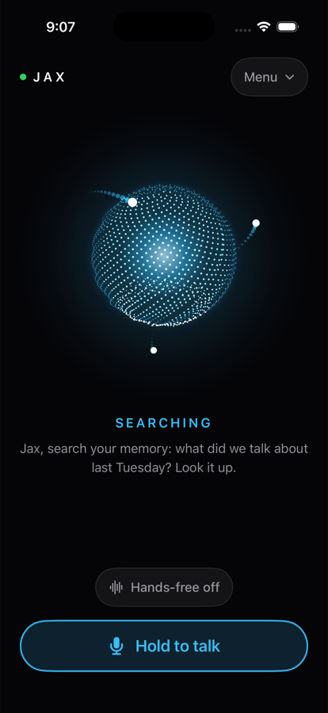
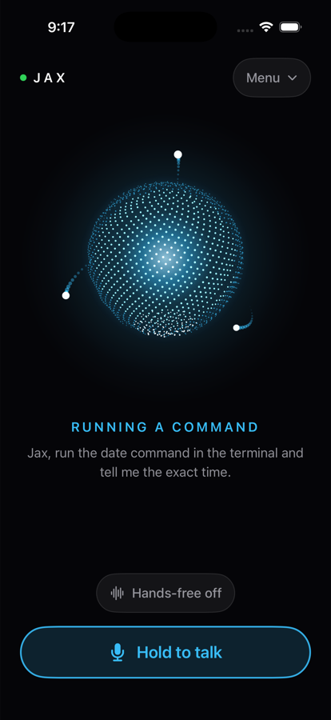
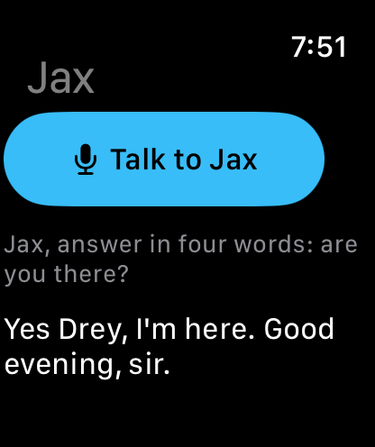
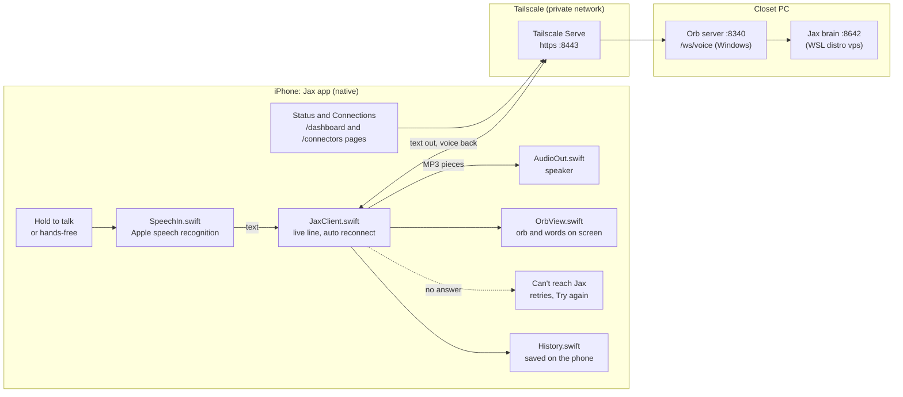

# Jax for iPhone

Talk to Jax from your phone. Hold the button, speak, let go. Jax answers out loud.

**Explain it in a meeting:** the app is a native iPhone screen with one live line to Jax on the closet PC. The phone turns your voice into text with Apple's own speech recognition, sends the text to Jax, and plays Jax's voice back as it arrives.

<p>
  
  
  
</p>

*Real screens from build 7: searching memory, running a command on the PC, and answering on the watch.*

## Why this exists

Jax is a personal AI assistant that lives on a computer at home (the closet PC). It remembers past conversations, runs commands, and reaches connected apps. Before this app, you could only talk to it at the desk. This app puts Jax in your pocket and on your wrist: hold a button, talk, hear the answer.

The point is one assistant everywhere, running on hardware you own, with your data staying at home.

## Where it's going

| Next | What it adds |
|---|---|
| Final app icon | Shortlist from the 50-idea board: 1, 5, 8, 14, 38 (dark with sky blue). |
| "Still thinking" voice line | Jax says a short line when a hard question takes more than about 8 seconds, so silence never feels broken. |
| New first screen | Two looks in the works, inspired by Hark and Grok. |
| Settings screen | Point the app at your own Jax server instead of a hardcoded address. Needed before others can use it. |
| Lock screen and Siri | Start a talk from the Action button, a widget, or "Hey Siri, ask Jax". |
| Background listening | Keep a conversation going with the screen off, like a phone call. |
| Watch on its own | Talk to Jax from the watch without the phone, once there's a safe public route to Jax. |
| Proactive Jax | Jax pings you first: reminders, finished jobs, morning brief. |
| Photos and files | Show Jax a picture or a document and ask about it. |

## Continue this in any AI

Everything needed to pick this up lives in this repo. Point any coding AI (Claude, Codex, Cursor, Grok) at [AGENTS.md](AGENTS.md) first. It explains the project, the rules, and how to build and ship.



Diagram source: [docs/diagrams/architecture.mmd](docs/diagrams/architecture.mmd)

## What it does

| Part | What you get |
|---|---|
| Hold to talk | Press and hold the big button, speak, let go. Letting go sends at once. Holding while Jax talks interrupts it. |
| Hands-free | The round button on the left. Jax listens all the time and a short pause ends your sentence. |
| The orb | Drawn on the phone, always fits the screen. It moves with your voice and with Jax's. |
| Words on screen | What Jax heard you say, then Jax's answer as text while it speaks. |
| Messages | Menu, top right. The whole conversation as chat bubbles, with a box to type in. Jax answers in text only while it is open. Its menu has "Text Jax in iMessage". Kept on this phone only. |
| On a Mac | Open TestFlight on an Apple silicon Mac and install Jax. It is the same iPhone build in a window. |
| On a watch | Installs with the phone app. Tap Talk to Jax, dictate, read the answer. The phone must be nearby with Tailscale on, because the watch talks to Jax through it. |
| Connections | Menu, top right. The PC's connectors page, where you add apps for Jax to use. |
| Status | Menu, top right. Opens the Jax dashboard. |
| Can't reach Jax | Shown when the PC or Tailscale does not answer. The app keeps retrying on its own, and there is a Try again button. |

## What must be true for it to work

1. Tailscale is installed on the phone and says Connected.
2. The closet PC (`YOUR-PC`) is on and someone is signed in. After a restart nothing answers until a sign-in.
3. The orb server is published at `https://your-jax-host:8443/` (Tailscale Serve).

The app talks only to that address. It is not reachable from the public internet.

## Why Swift

Drey's default language is TypeScript. TestFlight only accepts native apps, and the microphone and speech recognition are native iOS features, so this project is Swift and SwiftUI. One language.

## Why native and not the web page

Build 1 wrapped the desktop orb page in a web view. On a real phone it could be pinched and zoomed, the orb did not fit, and the page's audio fought the phone's microphone, so Jax often did not hear. Build 2 drops the page. The app speaks the same message channel the page uses (`/ws/voice` on the orb server), so nothing on the PC changed.

```
You hold and speak -> SpeechIn.swift (Apple speech recognition) -> text
text -> JaxClient.swift -> wss .../ws/voice -> orb server -> Jax brain
Jax's voice (MP3 pieces) -> JaxClient.swift -> AudioOut.swift -> speaker
```

## Where the speed comes from

- The microphone is already running before you press, and the last 0.4 seconds are kept, so your first word is not clipped.
- Letting go sends your words after a 0.25 second settle. There is no "wait for silence".
- The speech recogniser is woken up when the app opens, so the first press is as quick as the tenth.
- "Thinking" shows the moment you let go, before Jax confirms.
- Jax's voice starts playing on the first piece, not after the whole answer.

What the app cannot speed up: Jax's own thinking time on the PC. That is the gap between "Thinking" and the first word. Measured on 2026-11-21: 3.0 seconds for a simple question, 8.5 seconds for one that needs memory.

## Files

| File | Job |
|---|---|
| `project.yml` | The whole Xcode project, as text. `xcodegen` turns it into `Jax.xcodeproj`. |
| `Sources/JaxApp.swift` | The talk screen and the server address. |
| `Sources/JaxClient.swift` | The live line to Jax: connect, reconnect, send words, track thinking and speaking. |
| `Sources/SpeechIn.swift` | Microphone and speech recognition, hold-to-talk and hands-free. |
| `Sources/AudioOut.swift` | Plays Jax's voice piece by piece and confirms each piece. |
| `Sources/OrbView.swift` | Draws the orb. |
| `Sources/History.swift` | Saves each exchange to a file on the phone and shows the Messages screen. |
| `Sources/WatchRelay.swift` | Takes words from the watch, asks Jax, sends the answer back. |
| `Watch/JaxWatchApp.swift` | The watch app: tap, dictate, read the answer. |
| `Sources/WebView.swift` | The Status and Connections sheets (the two web pages left), zoom locked. |
| `scripts/make-icon.swift` | Draws the app icon. |

## Build and run

Needs Xcode 26 and `xcodegen` (`brew install xcodegen`).

```bash
cd ~/My\ Apps/jax-ios && xcodegen generate
```

```bash
open Jax.xcodeproj
```

Pick an iPhone simulator and press Run. The Mac must be on the tailnet for the orb to load.

Test switches (launch arguments, debug builds):

| Argument | Effect |
|---|---|
| `-JaxURL https://10.255.255.1:8443/` | Points the app at an address that never answers, to see the Can't reach Jax state. |
| `-JaxSay "hello Jax"` | Pretends you said the sentence. The Simulator has no speech model, so this is how to test the full loop there. |

## Ship to TestFlight

1. Raise `CURRENT_PROJECT_VERSION` in `project.yml` (every upload needs a new number), then `xcodegen generate`.
2. In Xcode: Product, Archive.
3. In the Organizer window: Distribute App, TestFlight Internal Only, Upload.
4. In App Store Connect, TestFlight tab: add the build to an internal group.

Settings used: team `ABCDE12345`, bundle ID `com.dreythomas.jax`, automatic signing. No secrets or keys live in this repo.

## Known limits

- Speech recognition cannot be tested in the Simulator (Apple ships no speech model there, error `kLSRErrorDomain 300`). It needs a real iPhone.
- Hands-free does not listen while Jax is speaking. Hold the button to interrupt.
- The app listens only while it is open and on screen.
- One hardcoded server address. Add a settings screen if a second one ever exists.

## Troubleshooting

| You see | Do this |
|---|---|
| Can't reach Jax | Open Tailscale on the phone. Check the PC is on and signed in. Tap Try again. |
| The PC answered, but Jax is not running | The orb server on the PC is down. From the Mac: `jax-pc open`. |
| It never hears you | Settings, Jax: turn on Microphone and Speech Recognition. |
| Need the phone's logs | Connect the phone, open Console on the Mac, filter by `com.dreythomas.jax`. The PC's orb log also gets a line for each step, starting `mic: ios:`. |
